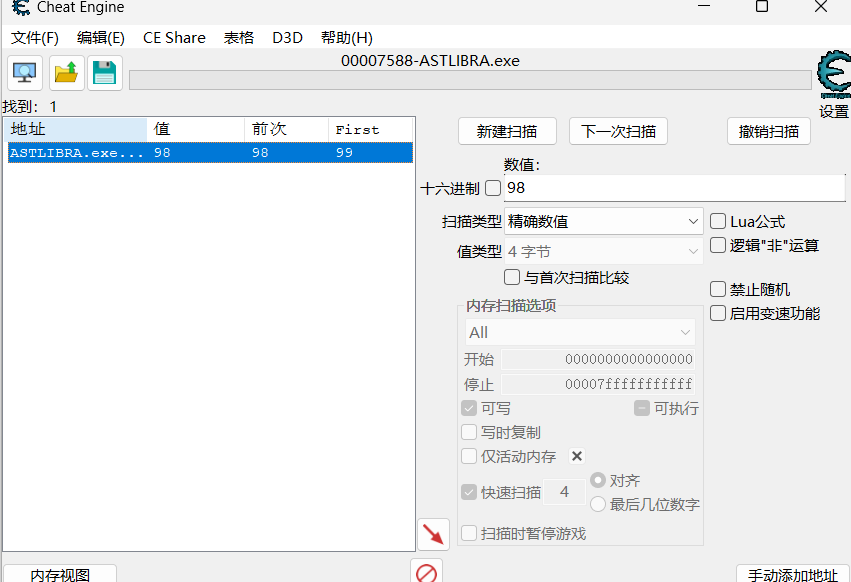
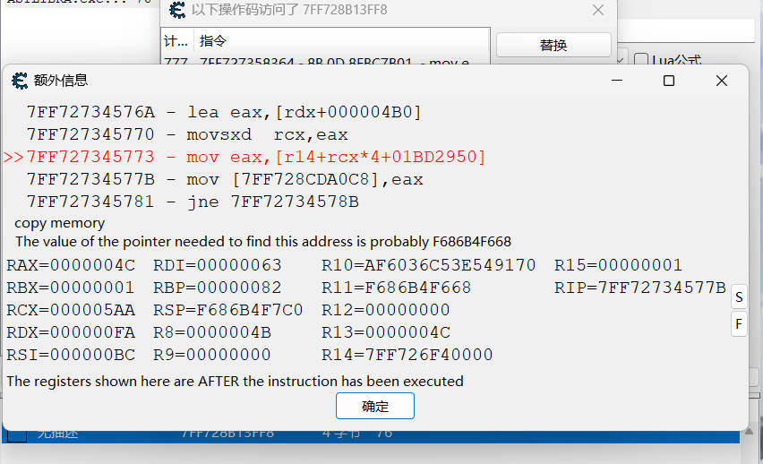
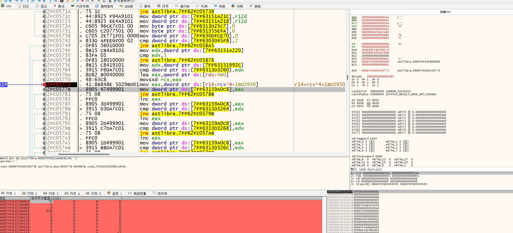
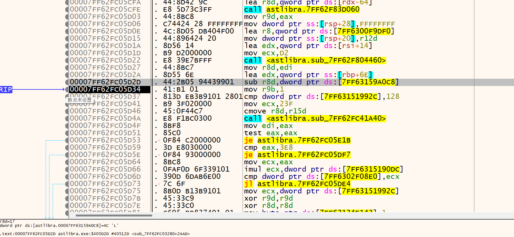
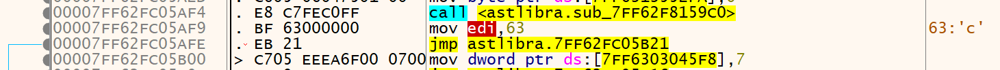

ce 打开ASTLIBRA进程

发现最大购买弓箭数被锁99，弓箭数购买到99

ce搜索99，用掉1弓箭再搜，98下一次扫描

找到内存弓箭数位置

尝试修改为120，回到游戏发现弓箭数为120，说明地址就是弓箭数量的内存地址

再找最大购买数量

能够购买的数量=最大购买数-拥有弓箭数

查看是什么访问弓箭数地址

发现最后一个在商店购买弓箭的时候出现，应该就是拿到拥有弓箭数去算能够购买的数量

复制地址，打开x64dbg，附加进程

在这里下断点

r14+rcx*4+1BD2950就是存放弓箭的基址

单步运行，弓箭数放到了7FF63159A0C8这个内存地址

那么在这个内存地址下一个4字节的硬件断点

运行，发现断在一个sub上，回到公式：购买的数量=最大购买数-拥有弓箭数

那么r8d就是存放最大购买数,回头找r8d的存储

发现是edi给的，继续找edi的mov edi，xxx

往上找找到，16进制 63=99

那么99就是最大购买数

